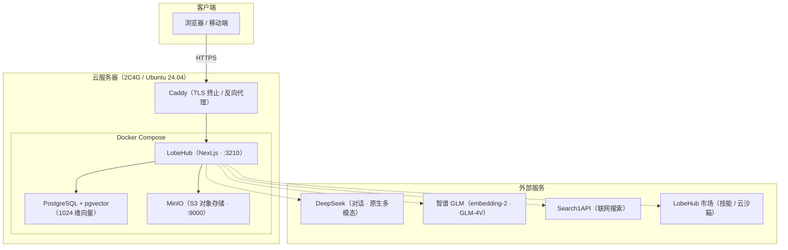
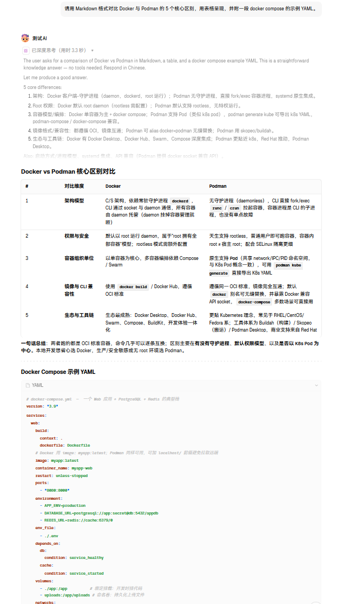
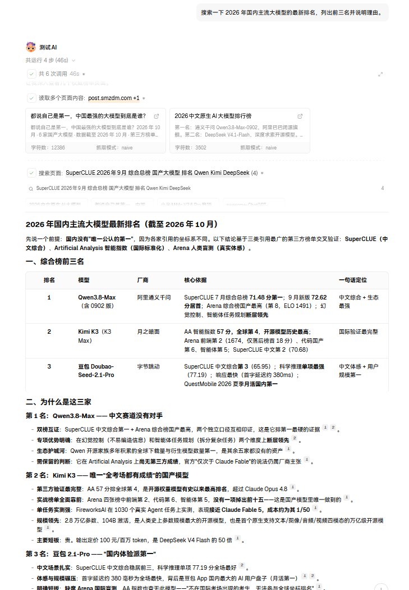
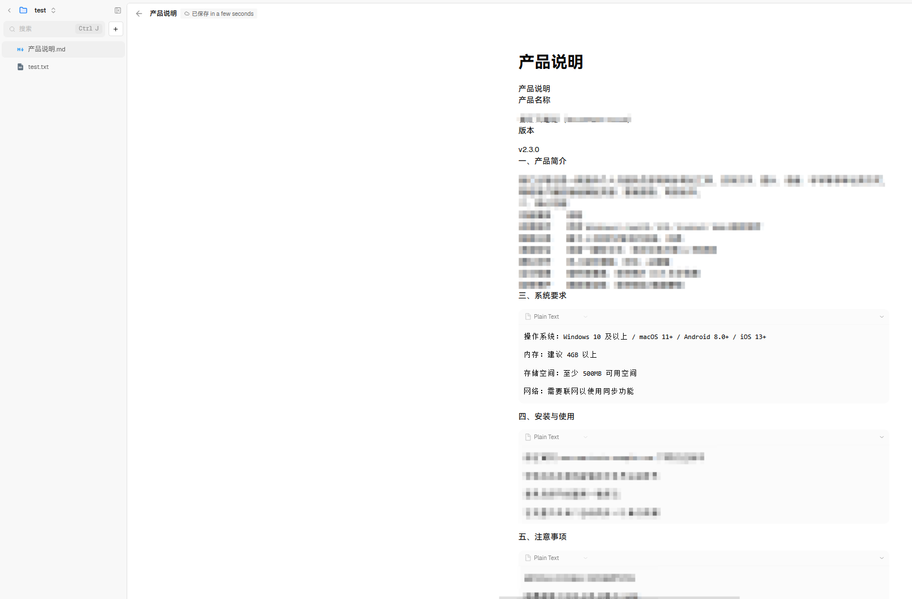
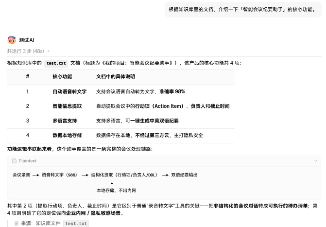
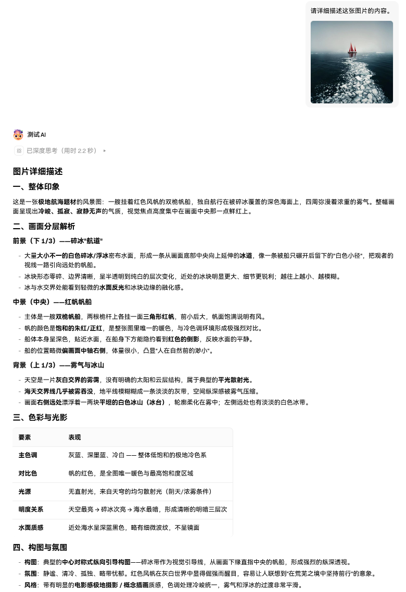
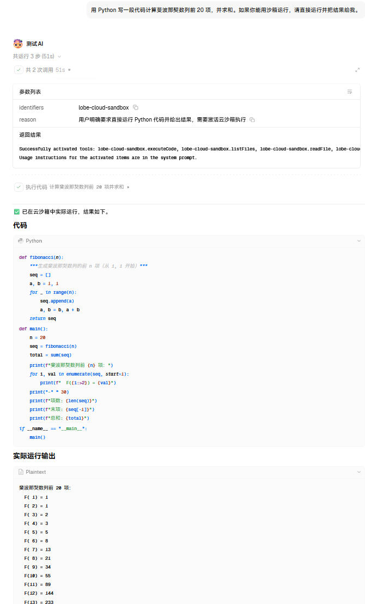

# LobeHub 私有化 AI 应用平台部署

> 从零搭建一套完全自主可控的 AI 应用平台，支持多端访问、知识库检索、联网搜索与多模态识别。数据完全自持，不依赖第三方 SaaS。

## 项目目标

- 在自有云服务器上部署 LobeHub，实现电脑 / 手机多端访问、单账户数据互通
- 打通对话、文件上传、截图识别、实时搜索、知识库问答五大能力
- 建立完整的密钥管理与安全加固体系

## 技术架构

## 功能演示

### 对话能力
> 结构化回复：Markdown 表格 + 代码块渲染



### 联网搜索
> 搜索 → 抓取 → 引用，完整链路



### 文件上传
> 上传文件并通过 S3 对象存储预览



### 知识库问答
> RAG 检索，回答带原文引用来源



### 视觉识别
> 多模态图片理解



### 云沙箱
> 云端代码执行，返回实际运行结果


## 技术栈

| 层 | 技术 |
|---|---|
| 应用 | LobeHub (Next.js) |
| 容器编排 | Docker Compose |
| 数据库 | PostgreSQL + pgvector |
| 对象存储 | MinIO（S3 兼容） |
| 模型 | DeepSeek V4.1-Flash / 智谱 GLM |
| 反向代理 | Caddy |
| 操作系统 | Ubuntu 24.04 LTS |

## 关键问题与解决方案

| # | 问题 | 根因 | 解决方案 |
|---|---|---|---|
| 1 | 文件上传报 CORS 错误 | S3 预签名 URL 的 host 取自 `S3_ENDPOINT`（容器内网名），浏览器无法解析 | 统一 `S3_ENDPOINT` 与 `S3_PUBLIC_DOMAIN` 为公网可达地址 |
| 2 | 知识库检索失败 | 数据库向量列固定 1024 维，embedding 模型维度不匹配 | 选用 1024 维的 embedding-2，并保证全链路维度一致 |
| 3 | 技能市场/云沙箱报 MARKET_AUTH_REQUIRED | 明文 HTTP 非安全上下文，`crypto.subtle` 不可用，PKCE 授权无法完成 | 引入 HTTPS 使页面进入 secure context |
| 4 | OAuth 登录被掐断 | 跨境代理中断 token 交换 | 将市场域名加入代理直连规则 |
| 5 | 部分网络访问被提示需备案 | 内地服务器对未备案域名的访问限制 | 完成 ICP 备案 + 443 端口收口 |

## 安全加固

- 所有密钥通过环境变量注入，真实配置不入版本库（`.gitignore` + `.env.example` 占位）
- 注册白名单（`AUTH_ALLOWED_EMAILS`），防止公网开放注册被薅
- 端口最小暴露原则，备案后收回至 `127.0.0.1` + 反向代理
- 关键密钥（`KEY_VAULTS_SECRET` 等）离线加密备份

## 快速开始

```bash
cp .env.example .env                        # 填入真实值
cp docker-compose.example.yml docker-compose.yml
docker compose up -d
目录结构
.
├── README.md
├── docker-compose.example.yml
├── .env.example
├── .gitignore
├── docs/
│   ├── architecture.md
│   └── troubleshooting.md
└── scripts/
    └── backup-config.sh
    ```mermaid
flowchart LR
    A["① 环境准备<br/>云服务器 · IPv4 修复"] --> B["② 容器部署<br/>Docker Compose"]
    B --> C["③ 功能调通<br/>对话/上传/搜索"]
    C --> D["④ 安全加固<br/>密钥管理 · 白名单"]
    D --> E["⑤ 域名备案<br/>HTTPS 收口"]
```